<div align="center">

<a href="#overview">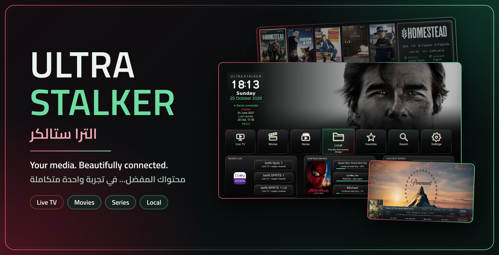</a>

<br />

[](https://github.com/K3bOra/UltraStalker/releases/latest)
[](#compatibility)
[](#compatibility)
[](https://github.com/K3bOra/UltraStalker/releases)

<a href="#install">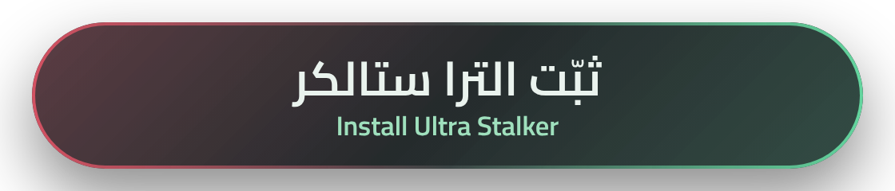</a>
<a href="https://github.com/K3bOra/UltraStalker/releases">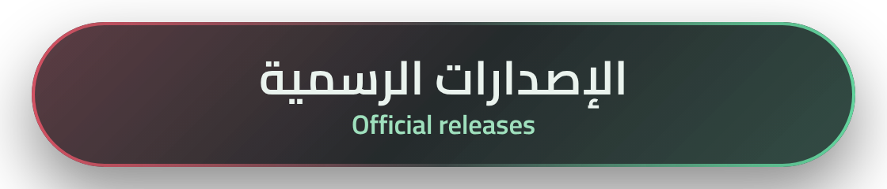</a>

<p dir="rtl"><b>محتواك المفضل… في تجربة واحدة متكاملة.</b></p>

**Your media. Beautifully connected.** Live TV, movies, series and your local library — built for Enigma2.

<p dir="rtl"><a href="#whats-new">الجديد</a> · <a href="#tour">الصور</a> · <a href="#features">المميزات</a> · <a href="#compatibility">التوافق</a> · <a href="#install">التثبيت</a> · <a href="#faq">الأسئلة</a></p>

[What's new](#whats-new) · [Tour](#tour) · [Features](#features) · [Compatibility](#compatibility) · [Install](#install) · [FAQ](#faq)

</div>

<a name="overview"></a>

<p align="center">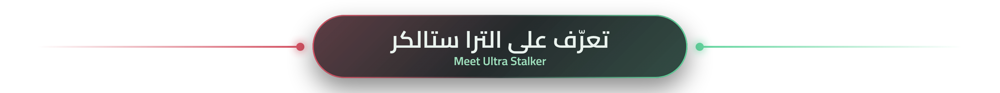</p>

<p dir="rtl">اجمع مصادر Portal وXtream وM3U في واجهة واحدة للبث المباشر، وتصفح الأفلام والمسلسلات بعرض سينمائي، والبحث الشامل، والمفضلة، ومحتوى الهارد والفلاشة — من غير التنقل بين بلجنات مختلفة.</p>

Bring Portal, Xtream and M3U sources together with Live TV, cinematic movie and series browsing, global search, favorites and HDD/USB media — without switching between plugins.

<p dir="rtl">واجهات داكنة وتدرجات هادئة من الأحمر للأخضر، مع حفظ الصور لإعادة استخدامها وتنقل واضح بالريموت، لتجربة متناسقة في كل الأقسام.</p>

Dark panels, subtle red-to-emerald accents, reusable artwork and straightforward remote navigation keep the experience consistent.

> <span dir="rtl">الترا ستالكر واجهة لتشغيل المحتوى. أضف مصادر المحتوى القانونية الخاصة بك؛ البلجن لا يتضمن اشتراكات أو محتوى محميًا بحقوق النشر.</span><br>
> Ultra Stalker is a media interface. Supply your own lawful content sources; no subscriptions or copyrighted content are included.

<a name="whats-new"></a>

<p align="center">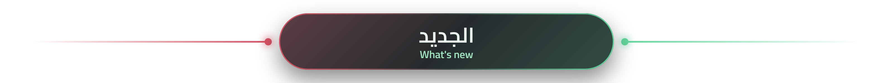</p>

<div align="center">

### Ultra Stalker V9.3.7 · Revision 586

</div>

<ul dir="rtl">
<li>إصلاحات أخطاء في الدريم بوكس.</li>
<li>إصلاح تداخل السيرفرات في الكروت الرئيسية.</li>
<li>تحسينات عامة للبلجن.</li>
</ul>

- Dreambox bug fixes.
- Fixed overlapping servers on the main cards.
- General plugin improvements.

[Full release notes and downloads](https://github.com/K3bOra/UltraStalker/releases/latest) · [Version history](CHANGELOG.md)

<a name="tour"></a>
<a name="experience"></a>

<p align="center">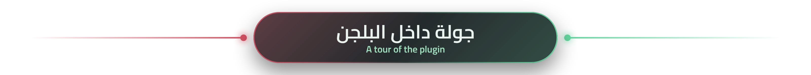</p>

<p align="center"><a href="docs/screenshots/02_home_cinematic.jpg">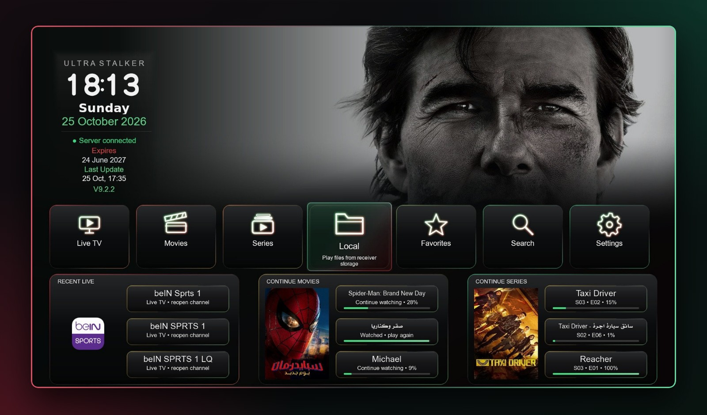</a></p>

<p dir="rtl" align="center"><b>الرئيسية</b> — اكتشف المحتوى، وارجع لآخر حاجة اتفرجت عليها، ووصل لمصادرك من شاشة واحدة.</p>
<p align="center"><b>Home</b> — discover content, return to recently viewed titles and reach your sources from one dashboard.</p>

<h3 align="center">Live TV · البث المباشر</h3>

<table>
<tr><td align="center" width="50%"><a href="docs/screenshots/03_live_tv.jpg">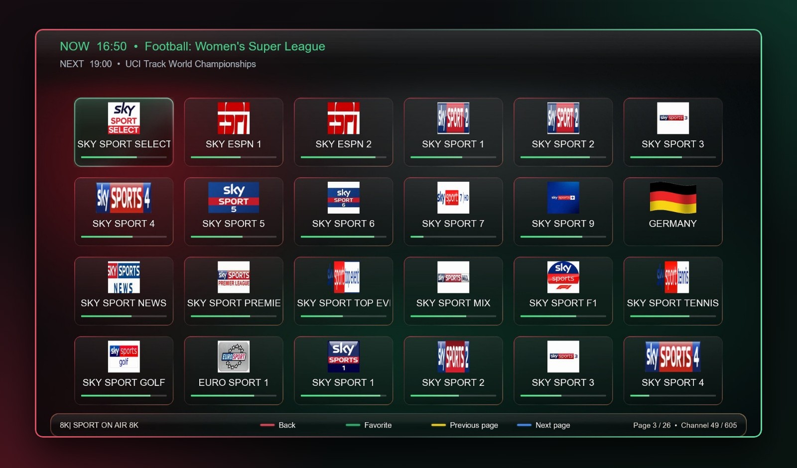</a><br /><b>شبكة القنوات</b><br /><sub>Live TV grid</sub></td><td align="center" width="50%"><a href="docs/screenshots/04_live_channels.jpg">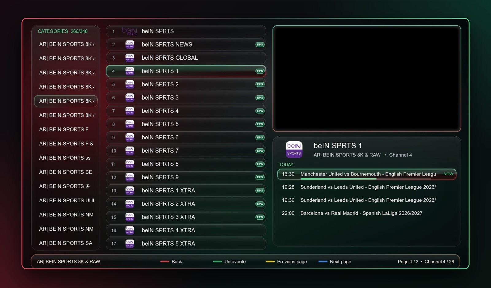</a><br /><b>قائمة القنوات</b><br /><sub>Channel browser</sub></td></tr>
</table>

<details>
<summary><b>دليل البرامج / Guide & EPG</b></summary>

<br />

<p align="center"><a href="docs/screenshots/05_live_epg.jpg">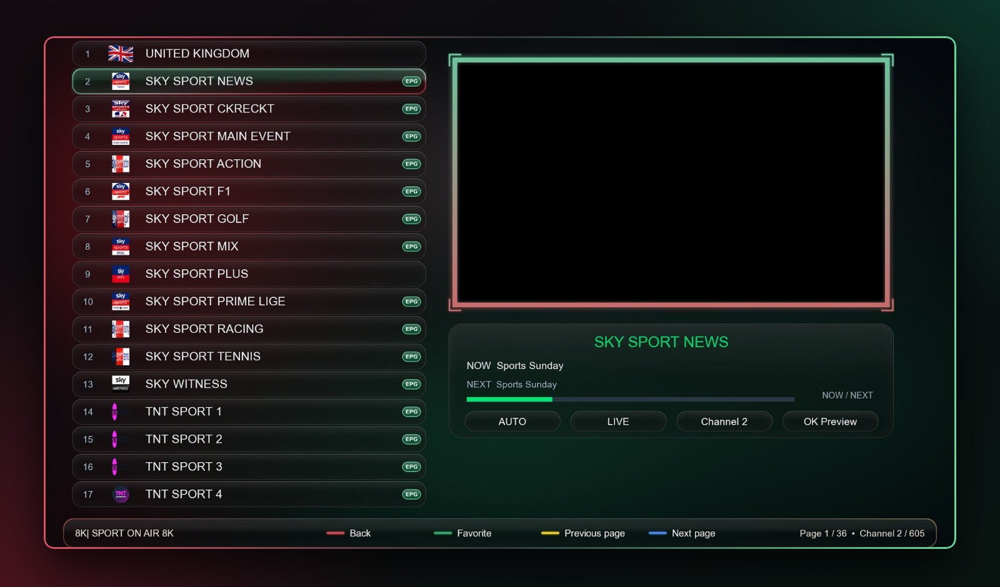</a></p>

</details>

<h3 align="center">Movies & Series · الأفلام والمسلسلات</h3>

<p align="center"><a href="docs/screenshots/16_series_grid_v3.jpg">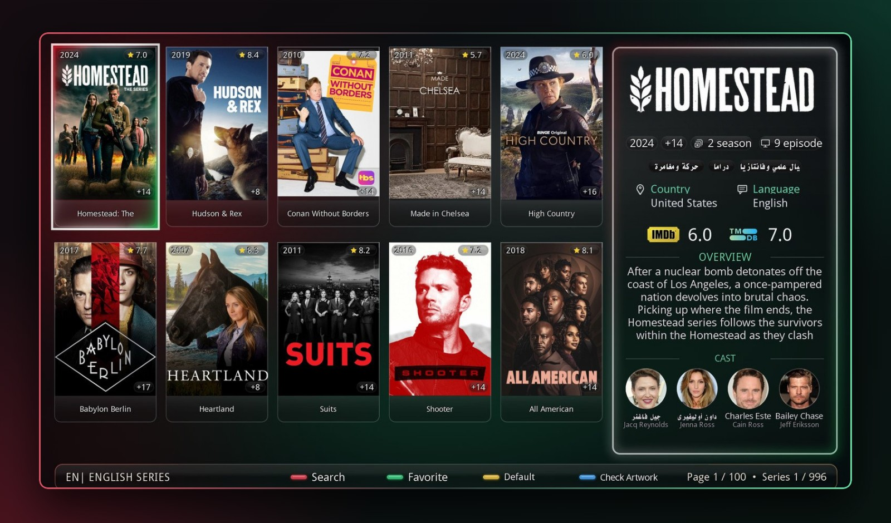</a></p>

<p dir="rtl" align="center"><b>شبكة البوسترات V3</b> — البوستر والتقييم والسن جنب لوحة التفاصيل، وطاقم العمل بالصور.</p>
<p align="center"><b>Poster grid V3</b> — posters, ratings and age badges beside a details panel with cast photos.</p>

<table>
<tr><td align="center" width="50%"><a href="docs/screenshots/17_movie_details_cinematic.jpg">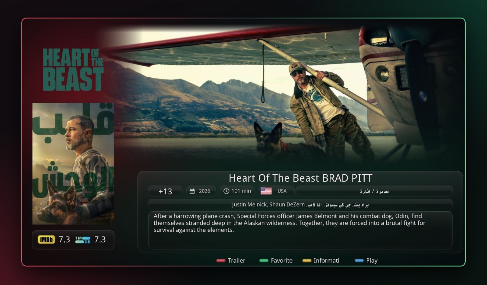</a><br /><b>تفاصيل الفيلم</b><br /><sub>Movie details</sub></td><td align="center" width="50%"><a href="docs/screenshots/18_series_details_cinematic.jpg">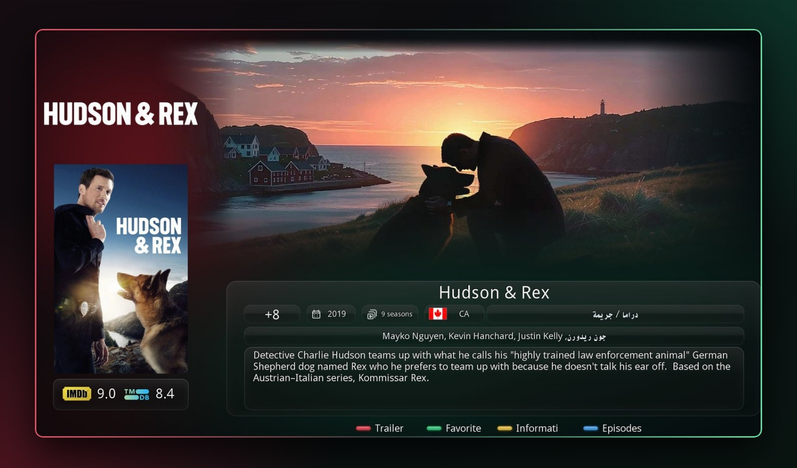</a><br /><b>تفاصيل المسلسل</b><br /><sub>Series details</sub></td></tr>
<tr><td align="center" width="50%"><a href="docs/screenshots/19_seasons.jpg">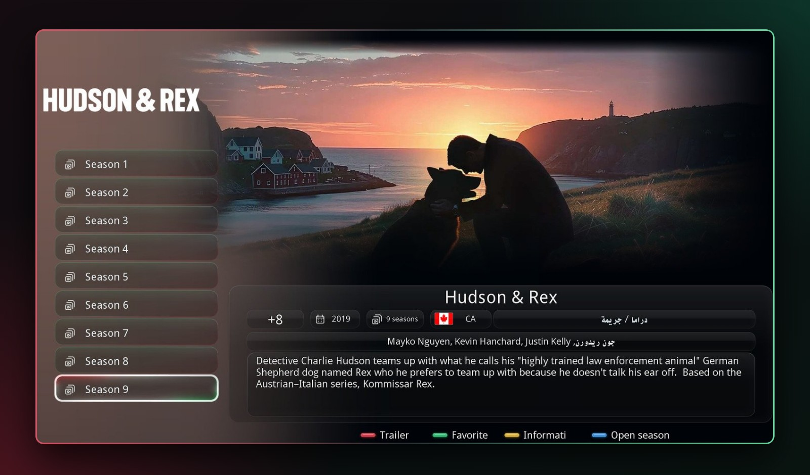</a><br /><b>المواسم</b><br /><sub>Seasons</sub></td><td align="center" width="50%"><a href="docs/screenshots/10_cinematic_browse.jpg">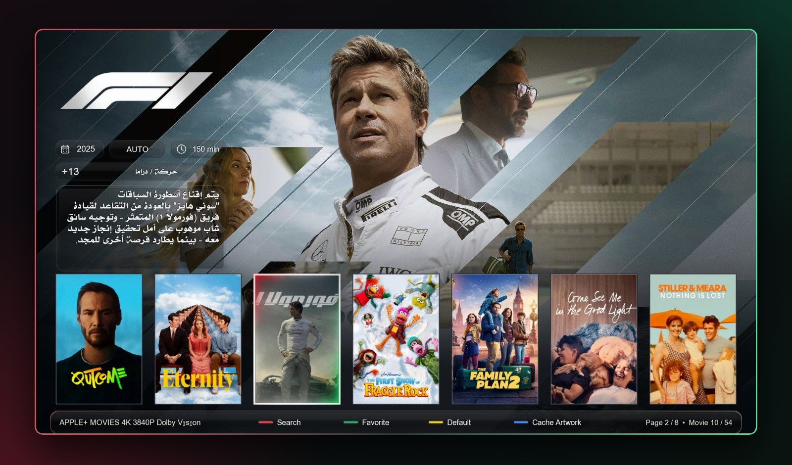</a><br /><b>التصفح السينمائي</b><br /><sub>Cinematic browsing</sub></td></tr>
</table>

<details>
<summary><b>المزيد من شاشات العرض السينمائي / More cinematic views</b></summary>

<br />

<table>
<tr><td align="center" width="50%"><a href="docs/screenshots/07_cinematic_discovery.jpg">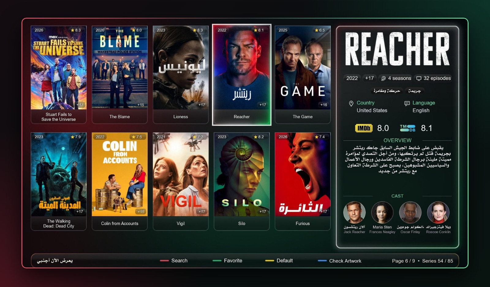</a><br /><b>اكتشاف المحتوى</b><br /><sub>Discovery</sub></td><td align="center" width="50%"><a href="docs/screenshots/08_poster_grid.jpg">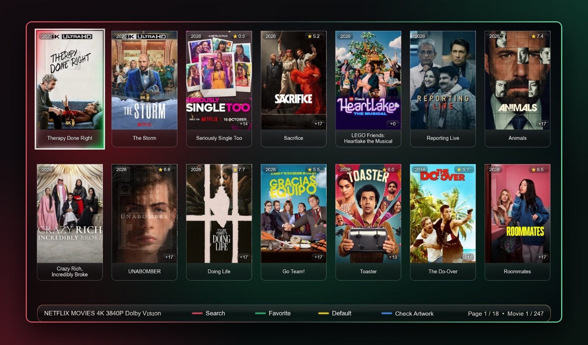</a><br /><b>شبكة البوسترات</b><br /><sub>Poster grid</sub></td></tr>
<tr><td align="center" width="50%"><a href="docs/screenshots/09_series_grid.jpg">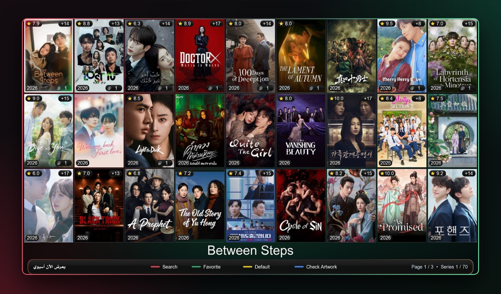</a><br /><b>شبكة المسلسلات</b><br /><sub>Series grid</sub></td><td align="center" width="50%"><a href="docs/screenshots/06_movie_details.jpg">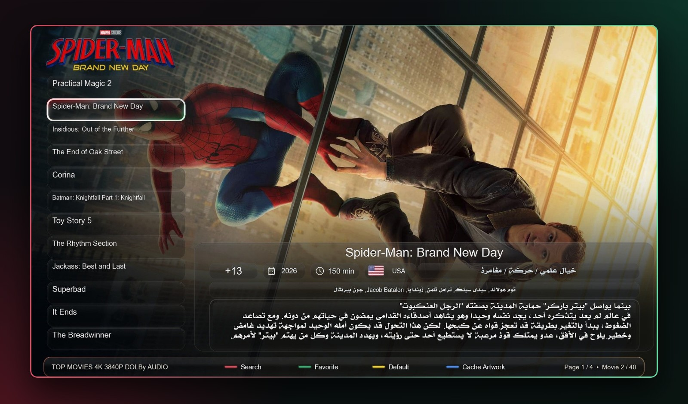</a><br /><b>تفاصيل الفيلم الكلاسيكية</b><br /><sub>Classic movie details</sub></td></tr>
<tr><td align="center" width="50%"><a href="docs/screenshots/13_series_details.jpg">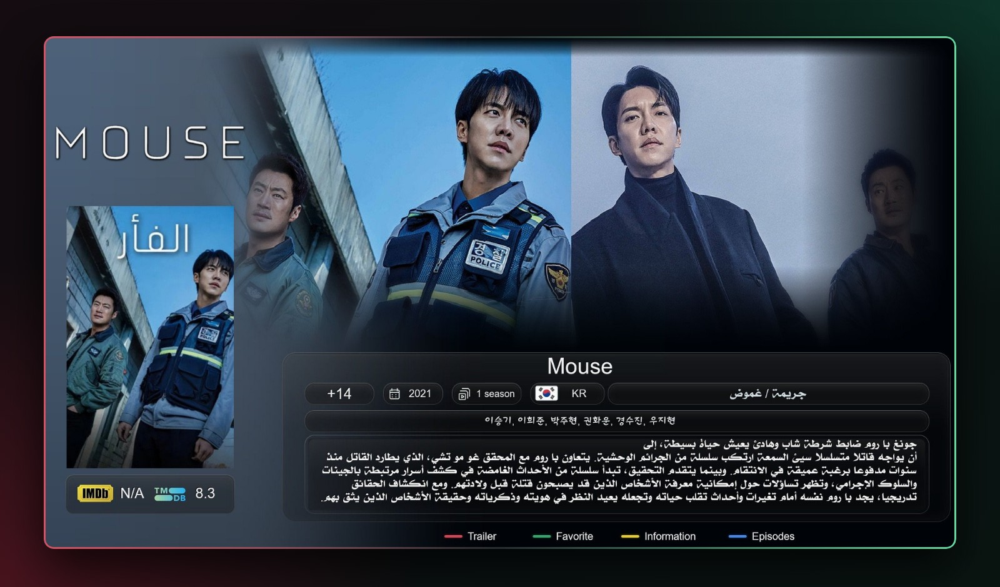</a><br /><b>تفاصيل المسلسل الكلاسيكية</b><br /><sub>Classic series details</sub></td><td></td></tr>
</table>

</details>

<h3 align="center">Player · التشغيل</h3>

<p align="center"><a href="docs/screenshots/20_player.jpg">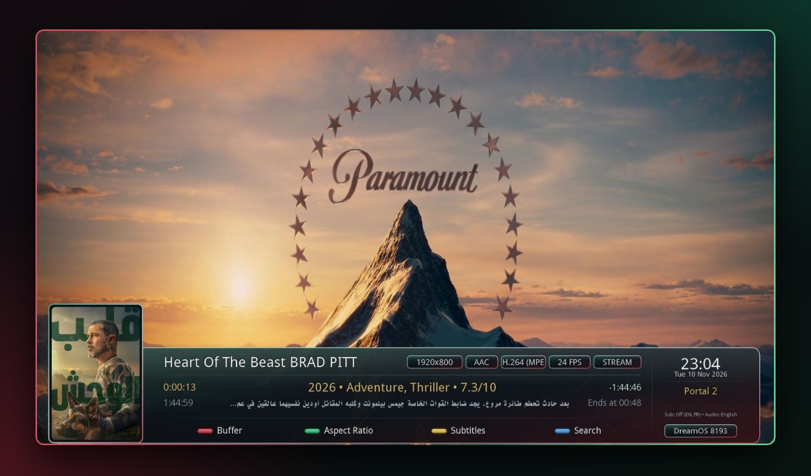</a></p>

<p dir="rtl" align="center"><b>شريط التشغيل</b> — الجودة والصوت والترجمة والوقت المتبقي، ومشغّل الدريم أو الأوبن ظاهر قدامك.</p>
<p align="center"><b>Player</b> — resolution, audio, subtitles and time left, with the active player engine shown.</p>

<h3 align="center">Search & library · البحث والمكتبة</h3>

<table>
<tr><td align="center" width="50%"><a href="docs/screenshots/14_search.jpg">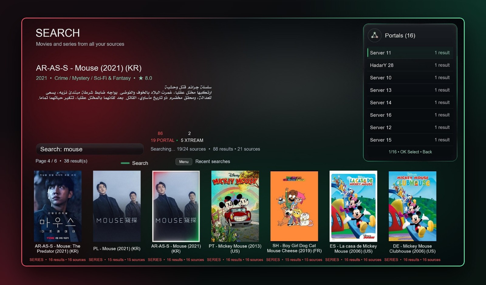</a><br /><b>البحث في كل المصادر</b><br /><sub>Search every source</sub></td><td align="center" width="50%"><a href="docs/screenshots/11_local_library.jpg">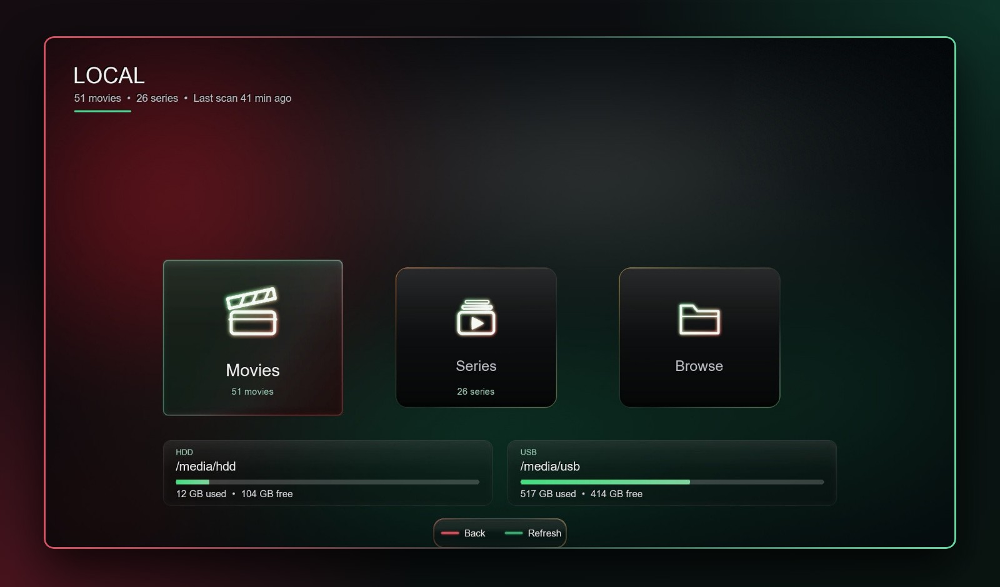</a><br /><b>المكتبة المحلية</b><br /><sub>Local library</sub></td></tr>
<tr><td align="center" width="50%"><a href="docs/screenshots/12_favorites.jpg">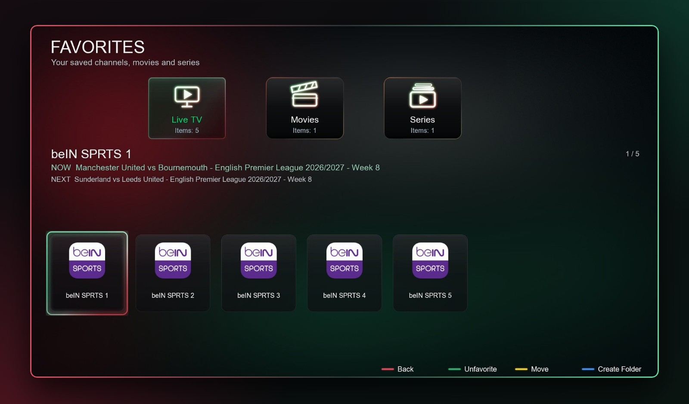</a><br /><b>المفضلة</b><br /><sub>Favorites</sub></td><td align="center" width="50%"><a href="docs/screenshots/21_source_cards.jpg">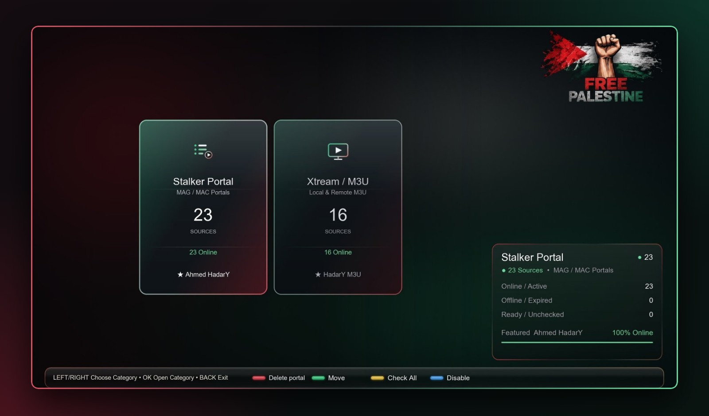</a><br /><b>كروت المصادر</b><br /><sub>Source cards</sub></td></tr>
</table>

<h3 align="center">Settings · الإعدادات</h3>

<table>
<tr><td align="center" width="50%"><a href="docs/screenshots/22_settings_panel.jpg">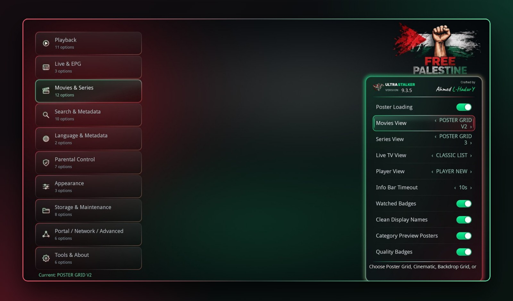</a><br /><b>لوحة الإعدادات</b><br /><sub>Settings panel</sub></td><td align="center" width="50%"><a href="docs/screenshots/15_settings.jpg">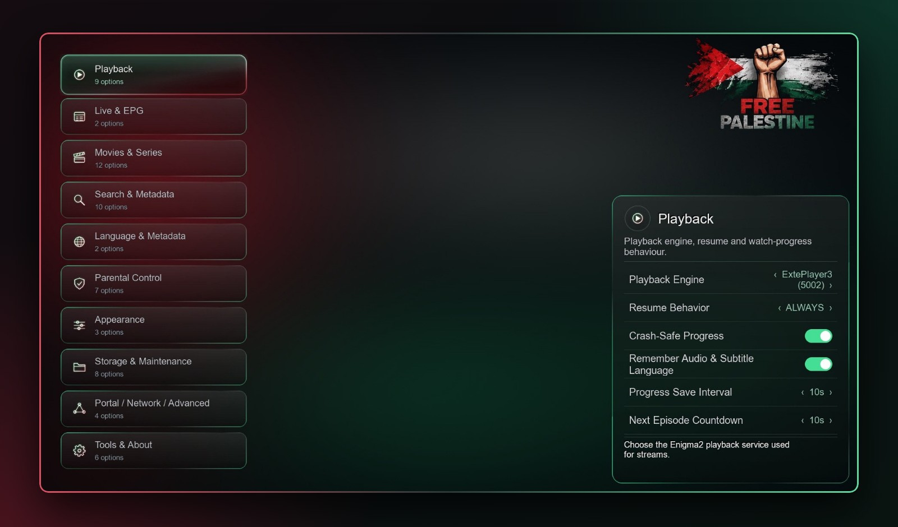</a><br /><b>الإعدادات الكاملة</b><br /><sub>All settings</sub></td></tr>
</table>

<details>
<summary><b>إدارة البورتلات / Portal manager</b></summary>

<br />

<p align="center"><a href="docs/screenshots/01_portal_manager_private.jpg">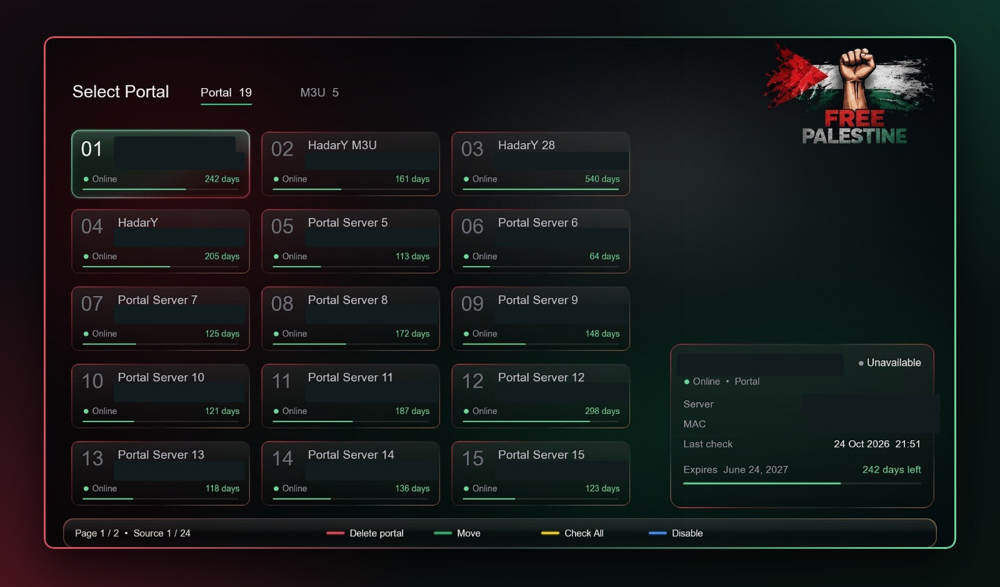</a></p>

<p dir="rtl">تم إخفاء بيانات الاتصال الظاهرة في صورة إدارة البورتلات نهائيًا قبل نشرها.</p>

Connection identifiers in the Portal Manager screenshot have been permanently redacted.

</details>

<a name="features"></a>

<p align="center">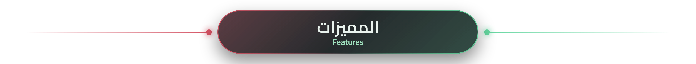</p>

<p align="center">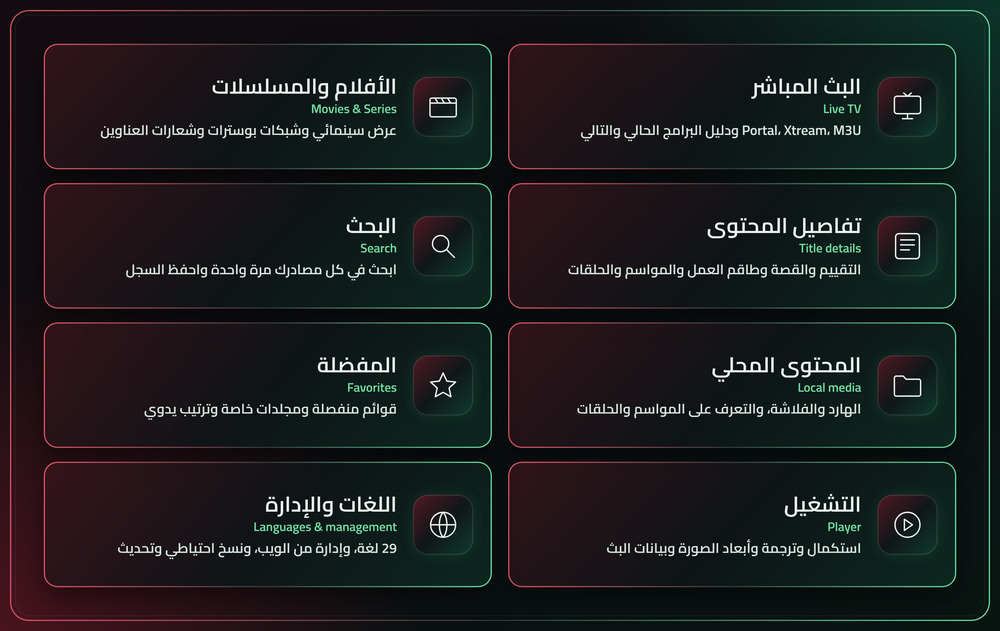</p>

<details>
<summary><b>تفاصيل المميزات كاملة / Full feature details</b></summary>

<br />

| العربية | English |
|:---|:---|
| <p dir="rtl"><b>البث المباشر</b><br>مصادر Portal وXtream وM3U، ودليل البرنامج الحالي والتالي، والتعرف على جودة البث وإعادة المحاولة تلقائيًا.</p> | **Live TV**<br>Portal, Xtream and M3U sources; Now/Next EPG; stream quality detection and automatic retry. |
| <p dir="rtl"><b>الأفلام والمسلسلات</b><br>عرض سينمائي وشبكات بوسترات، ومطابقة بيانات المحتوى والصور وشعارات العناوين عند توفرها.</p> | **Movies & Series**<br>Cinematic and poster grid views, metadata matching, artwork and title logos when available. |
| <p dir="rtl"><b>تفاصيل المحتوى</b><br>وصف وتقييم وتصنيفات وطاقم العمل والمدة والكاتب والمخرج عند توفر البيانات.</p> | **Title details**<br>Overviews, ratings, genres, cast, runtime, writers and directors when metadata is available. |
| <p dir="rtl"><b>البحث</b><br>البحث في القنوات والأفلام والمسلسلات، واكتشاف المحتوى على السيرفر وحفظ سجل البحث.</p> | **Search**<br>Live TV, movies and series search, server-wide discovery and search history. |
| <p dir="rtl"><b>المحتوى المحلي</b><br>فهرسة الهارد والفلاشة، وتصفح المجلدات والتعرف على المواسم والحلقات.</p> | **Local media**<br>HDD/USB indexing, folder browsing and season/episode recognition. |
| <p dir="rtl"><b>المفضلة</b><br>قوائم مفضلة منفصلة ومجلدات مخصصة وترتيب يدوي.</p> | **Favorites**<br>Separate favorites, custom folders and manual ordering. |
| <p dir="rtl"><b>التشغيل</b><br>استكمال المشاهدة، وضبط أبعاد الصورة وخيارات الترجمة ومعلومات التشغيل.</p> | **Playback**<br>Resume, aspect ratio controls, subtitle options and playback information. |
| <p dir="rtl"><b>اللغات</b><br>٢٩ لغة للواجهة مع دعم الكتابة من اليمين لليسار.</p> | **Languages**<br>29 interface languages with right-to-left support. |
| <p dir="rtl"><b>الأداء</b><br>حفظ صور المحتوى لإعادة استخدامها وتقليل طلبات TMDb المتكررة.</p> | **Performance**<br>Persistent artwork cache and fewer repeated TMDb requests. |
| <p dir="rtl"><b>الإدارة</b><br>إدارة المصادر من الويب، والنسخ الاحتياطي والاستعادة والتصدير والتحديث أونلاين.</p> | **Management**<br>Web-based source management, backup/restore, export and online updates. |

</details>

<details>
<summary><b>مميزات إضافية / Advanced capabilities</b></summary>

<br />

<ul dir="rtl">
<li>إعادة استخدام البوسترات والخلفيات والشعارات، مع تفضيل تريلر بدقة 1080p عند دعمه.</li>
<li>التعرف على حلقات المسلسلات المحلية بأسماء مثل <code dir="ltr">S01E01</code> و<code dir="ltr">1x01</code>.</li>
<li>المحتوى المحلي يظل متاحًا عند انقطاع البورتال.</li>
<li>تصدير المحتوى إلى باقات Enigma2 وقوائم M3U.</li>
<li>ترجمة مدمجة وخارجية وأونلاين، مع تكامل SubsSupport عند توفره.</li>
<li>التحديثات مصممة للحفاظ على البورتلات والمفضلة والسجل والصور المحفوظة.</li>
</ul>

- Reusable posters, backdrops and logos, with 1080p trailer preference when supported.
- Local series recognition using names such as `S01E01` and `1x01`.
- Local media remains available when a remote Portal is offline.
- Enigma2 Bouquet and M3U export.
- Embedded, external and online subtitles, with SubsSupport integration when available.
- Upgrades are designed to preserve portals, favorites, history and artwork caches.

</details>

<a name="compatibility"></a>

<p align="center">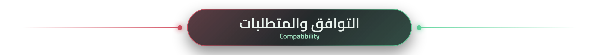</p>

| المتطلب · Requirement | التفاصيل · Details |
|:---|:---|
| المنصة · Platform | <span dir="rtl">أجهزة استقبال Enigma2</span> · Enigma2 receivers |
| بايثون · Python | Open: 3.12–3.15 · DreamOS: 2.7 |
| الحزمة · Package | Open: `opkg` / IPK · DreamOS: DEB |
| الوصول · Access | <span dir="rtl">حساب root عبر Telnet أو SSH</span> · Root via Telnet / SSH |
| المصادر · Sources | Stalker Portal · Xtream Codes · M3U |
| التخزين · Storage | <span dir="rtl">هارد أو فلاشة للمحتوى المحلي</span> · HDD / USB for local media |

<p dir="rtl">دي متطلبات الحزمة المنشورة، وليست تأكيدًا إن كل جهاز وصورة تشغيل تم اختبارهم عمليًا.</p>

These are the published package requirements, not confirmation that every receiver and image has been tested.

<a name="install"></a>

<p align="center">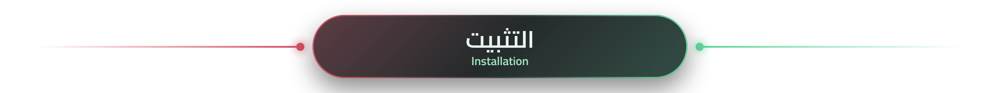</p>

<p align="center">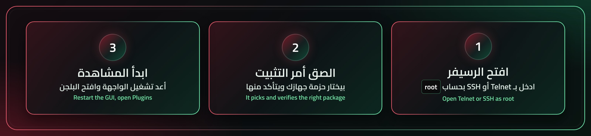</p>

```sh
wget -qO- https://raw.githubusercontent.com/K3bOra/UltraStalker/main/install.sh | /bin/sh
```

<p dir="rtl">نفس الأمر يختار تلقائيًا IPK للأوبن/Python 3 أو DEB للدريم/Python 2.7. المُثبّت يقرأ أحدث إصدار رسمي، ويتحقق من حجم الحزمة وبصمة SHA-256 واسمها ورقمها ومعماريتها قبل التثبيت باستخدام <code dir="ltr">opkg</code> للأوبن أو <code dir="ltr">dpkg</code> للدريم.</p>

The same command automatically selects IPK for Open/Python 3 or DEB for DreamOS/Python 2.7. The installer reads the latest official release and checks the package size, SHA-256, name, version and architecture before installing with `opkg` on Open or `dpkg` on DreamOS.

> [!NOTE]
> <span dir="rtl">التثبيت قد يعيد تشغيل واجهة Enigma2. احتفظ بنسخة احتياطية من إعدادات الرسيفر المهمة أولًا.</span><br>
> Installation may restart Enigma2. Back up important receiver settings first.

[Review the installer](install.sh) · [Download the latest packages](https://github.com/K3bOra/UltraStalker/releases/latest)

<a name="faq"></a>

<p align="center">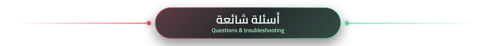</p>

<details>
<summary><b>التثبيت فشل — أراجع إيه؟ · Installation failed</b></summary>

<p dir="rtl">تأكد إنك داخل بحساب <b>root</b>، وإن بايثون <b>3.12–3.15</b>، والإنترنت شغال وفيه مساحة مؤقتة كافية. احتفظ برسالة الخطأ كاملة لو هتبلغ عن المشكلة.</p>

Check that you are using **root**, Python **3.12–3.15**, an active internet connection and enough free temporary storage. Keep the full error output when reporting a problem.

</details>

<details>
<summary><b>البورتال مش متصل — هل مكتبتي ضاعت؟ · My Portal is offline</b></summary>

<p dir="rtl">المحتوى المحلي يظل متاحًا. راجع بيانات المصدر المحفوظة والاتصال من إدارة البورتلات.</p>

Local media remains available. Check your saved source details and connection in Portal Management.

</details>

<details>
<summary><b>البوسترات أو صور المحتوى مش ظاهرة · Posters or artwork are missing</b></summary>

<p dir="rtl">راجع اتصال الإنترنت واديه وقت في أول تصفح. الصور تعتمد على مطابقة بيانات المحتوى، وبعد تحميلها بتتحفظ للاستخدام بعد كده.</p>

Check the internet connection and allow time on the first browse. Artwork depends on metadata matching and is cached for later use.

</details>

<details>
<summary><b>هل التحديث هيمسح إعداداتي؟ · Will an update remove my settings?</b></summary>

<p dir="rtl">التحديثات مصممة للحفاظ على البورتلات والمفضلة والسجل والصور المحفوظة. احتفظ بنسخة احتياطية من إعدادات الرسيفر المهمة.</p>

Upgrades are designed to preserve portals, favorites, history and artwork caches. Keep a backup of important receiver settings.

</details>

<details>
<summary><b>أبلغ عن مشكلة إزاي؟ · How do I report a problem?</b></summary>

<p dir="rtl"><a href="https://github.com/K3bOra/UltraStalker/issues">افتح بلاغ مشكلة</a>، واكتب موديل الرسيفر واسم الصورة وإصدار بايثون والبلجن وخطوات ظهور المشكلة ورسالة الخطأ كاملة. امسح بيانات الاتصال الخاصة قبل النشر.</p>

[Open an issue](https://github.com/K3bOra/UltraStalker/issues) with the receiver model, image, Python version, plugin version, steps to reproduce and full error text. Remove private connection details first.

</details>

<a name="ultra-family"></a>

<p align="center">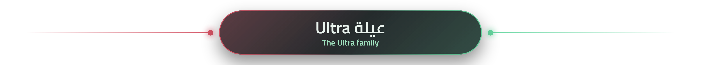</p>

<p align="center">
<a href="https://github.com/K3bOra/UltraQuran">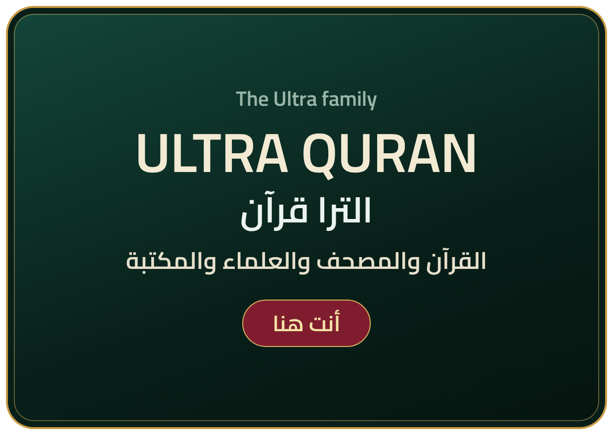</a>
<a href="https://github.com/K3bOra/UltraStalker">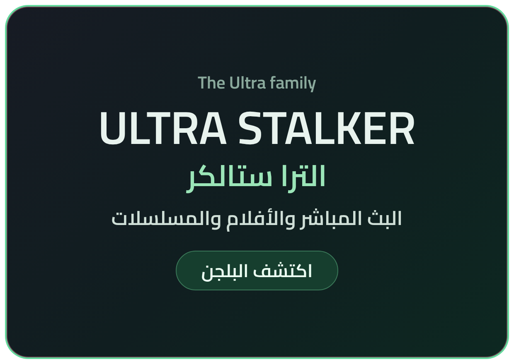</a>
<a href="https://github.com/K3bOra/UltraAudio">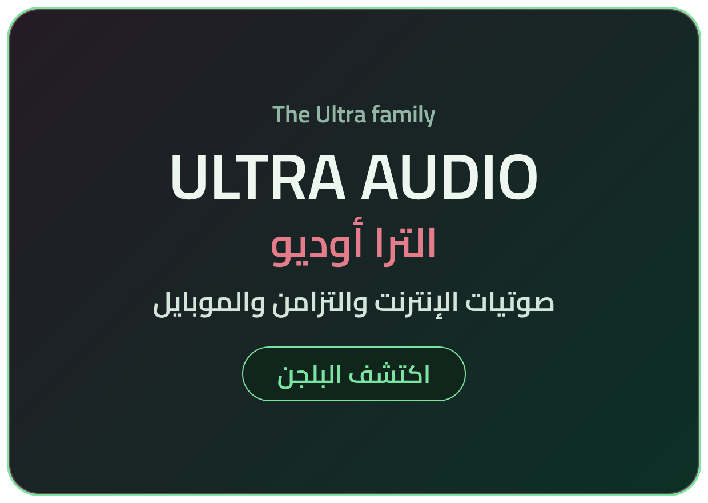</a>
</p>

<p dir="rtl" align="center">تلات بلجنات من عيلة واحدة، ولكل واحد أمر تثبيت وتحديثات رسمية خاصة بيه.</p>
<p align="center">Three plugins, one family. Each has its own install command and official updates.</p>

<a name="resources"></a>

<p align="center">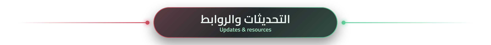</p>

<p dir="rtl">المُثبّت ومحدّث البلجن الحالي بيعتمدوا على ملف بيانات أحدث إصدار رسمي، والنسخة الموجودة في المستودع بتتزامن بعد النشر.</p>

The installer and current plugin updater use the manifest attached to the latest official release. The repository copy is synchronized after publishing.

- [Official releases](https://github.com/K3bOra/UltraStalker/releases) · [الإصدارات الرسمية](https://github.com/K3bOra/UltraStalker/releases)
- [Latest release manifest](https://github.com/K3bOra/UltraStalker/releases/latest/download/update.json) · [ملف بيانات أحدث إصدار](https://github.com/K3bOra/UltraStalker/releases/latest/download/update.json)
- [Repository manifest](update.json) · [نسخة بيانات التحديث في المستودع](update.json)
- [Version history](CHANGELOG.md) · [سجل الإصدارات](CHANGELOG.md)
- [Publishing guide](RELEASING.md) · [دليل نشر الإصدارات](RELEASING.md)

<a name="privacy"></a>

<p align="center">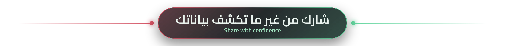</p>

<p dir="rtl">قبل مشاركة الصور أو سجلات الأخطاء، امسح روابط البورتلات وعناوين السيرفر وأرقام MAC وأسماء المستخدمين وكلمات المرور ومفاتيح API ورموز الوصول.</p>

Before sharing screenshots or error logs, remove Portal URLs, server IPs, MAC addresses, usernames, passwords, API keys and access tokens.

<p dir="rtl">المشروع منشور بترخيص <a href="LICENSE">MIT</a>.</p>

Released under the [MIT License](LICENSE).

<br />

<p align="center">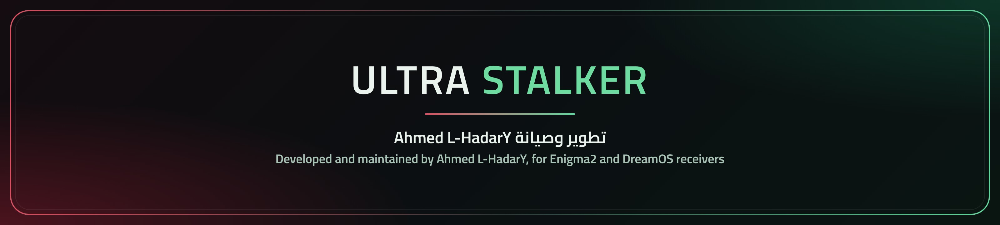</p>
