<div align="center">

[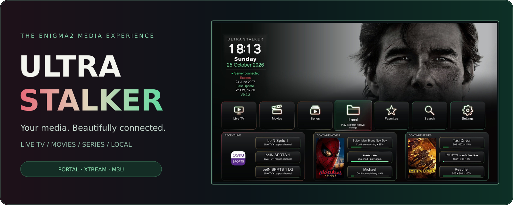](assets/ultrastalker-hero.png)

### One premium experience for Live TV, Movies, Series, Local Media & more.

**تجربة ترفيه متكاملة لأجهزة Enigma2 — بث مباشر، أفلام، مسلسلات ومكتبتك المحلية.**

<br>

[](#)
[](https://github.com/K3bOra/UltraStalker/releases/latest)
[](update.json)
[](install.sh)

[](LICENSE)
[](https://github.com/K3bOra/UltraStalker/commits/main)
[](https://github.com/K3bOra/UltraStalker/releases)
[](https://github.com/K3bOra/UltraStalker/stargazers)

<br>

**[Screenshots](#-the-experience) · [Features](#-built-around-your-media) · [Install](#-ready-to-get-started) · [What's New](#-whats-new) · [FAQ](#-troubleshooting--faq) · [الشرح بالعربي](#-الدليل-السريع-بالعربي)**

<br>

[](#-ready-to-get-started) &nbsp;&nbsp; [](https://github.com/K3bOra/UltraStalker/releases)

</div>

---

## 📑 Contents

- [Overview](#-meet-ultra-stalker)
- [The Experience — Screenshots](#-the-experience)
- [Features](#-built-around-your-media)
- [Compatibility](#-compatibility)
- [Installation](#-ready-to-get-started)
- [What's New](#-whats-new)
- [Updates & Resources](#-stay-up-to-date)
- [Troubleshooting & FAQ](#-troubleshooting--faq)
- [الدليل السريع بالعربي](#-الدليل-السريع-بالعربي)
- [Privacy](#-share-with-confidence)
- [License](#-license)

---

[](assets/section-overview.svg)

## 🚀 Meet Ultra Stalker

**Ultra Stalker** brings Portal, Xtream and M3U services together with a premium media experience built for Enigma2 receivers. Go from Live TV to cinematic movie discovery, series, local media, favorites and global search without switching between plugins.

The interface is designed around elegant dark panels, subtle red-to-emerald accents, fast browsing, intelligent artwork caching and straightforward remote-control navigation.

> **Please note:** Ultra Stalker is a media interface. You must supply your own legal content sources. No subscriptions or copyrighted content are included.

---

[](assets/section-gallery.svg)

## 🎬 The Experience

### 🏠 Home — Your media, beautifully arranged

A single dashboard for media discovery, recently viewed content, source status and quick access to the features that matter.

[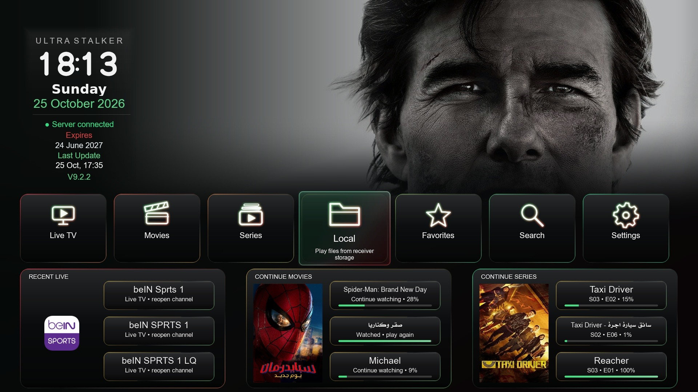](docs/screenshots/02_home_cinematic.jpg)

### 📺 Live TV — Premium channel navigation

Browse categories, channels and guide information in a cohesive TV-first experience.

| [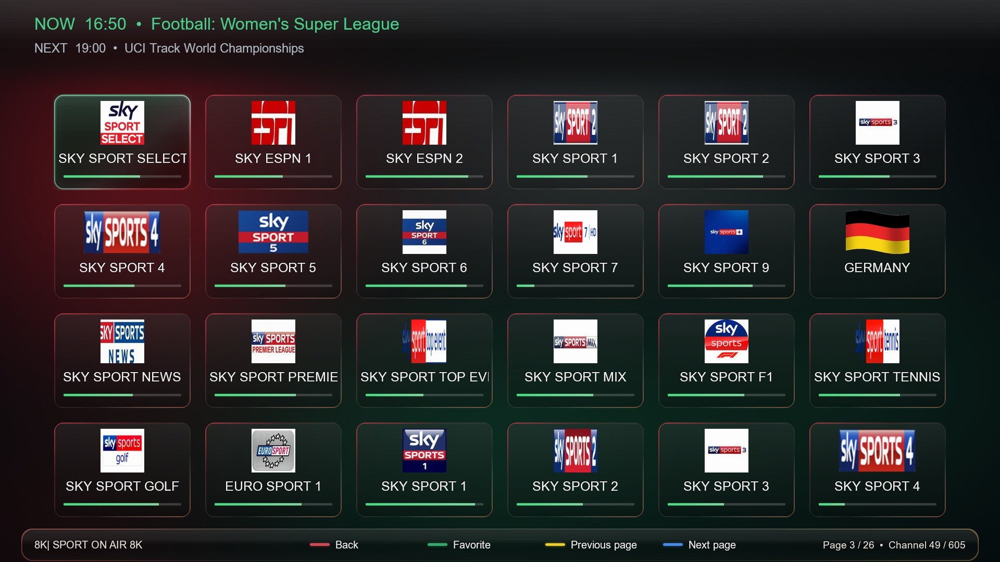](docs/screenshots/03_live_tv.jpg)<br>**Live TV Grid** | [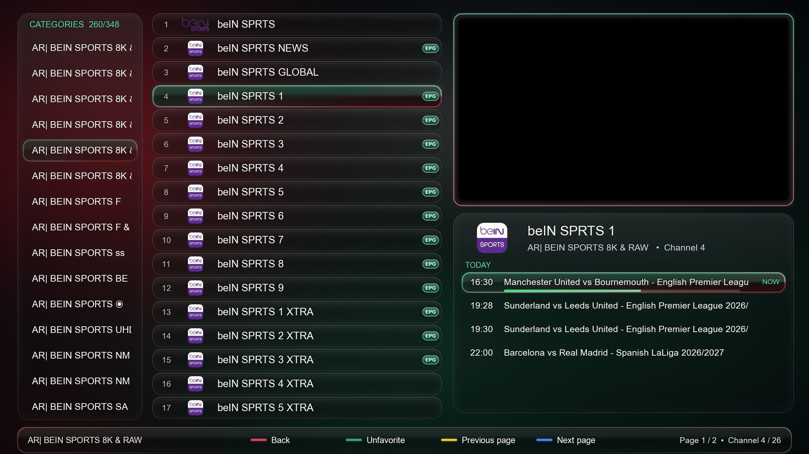](docs/screenshots/04_live_channels.jpg)<br>**Channel Browser** |
|:---:|:---:|

<details>
<summary><b>More Live TV — Guide & EPG view</b></summary>

<br>

[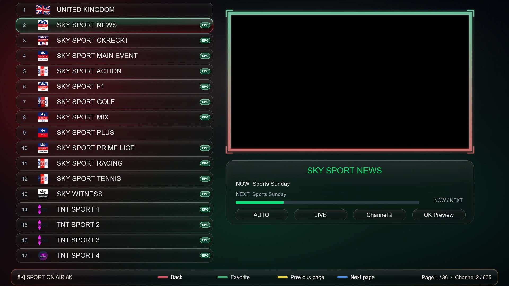](docs/screenshots/05_live_epg.jpg)

</details>

### 🎞️ Movies & Series — Cinematic discovery

Poster grids, cinematic backdrops, artwork, cast and metadata are brought together in a premium browsing experience.

| [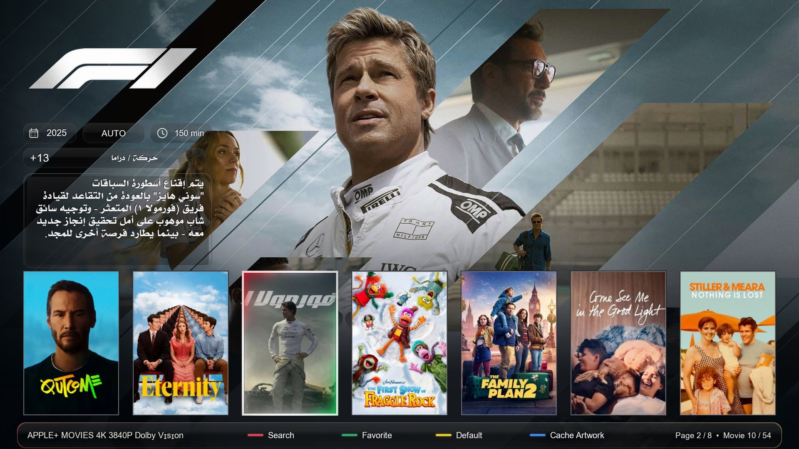](docs/screenshots/10_cinematic_browse.jpg)<br>**Cinematic Browsing** | [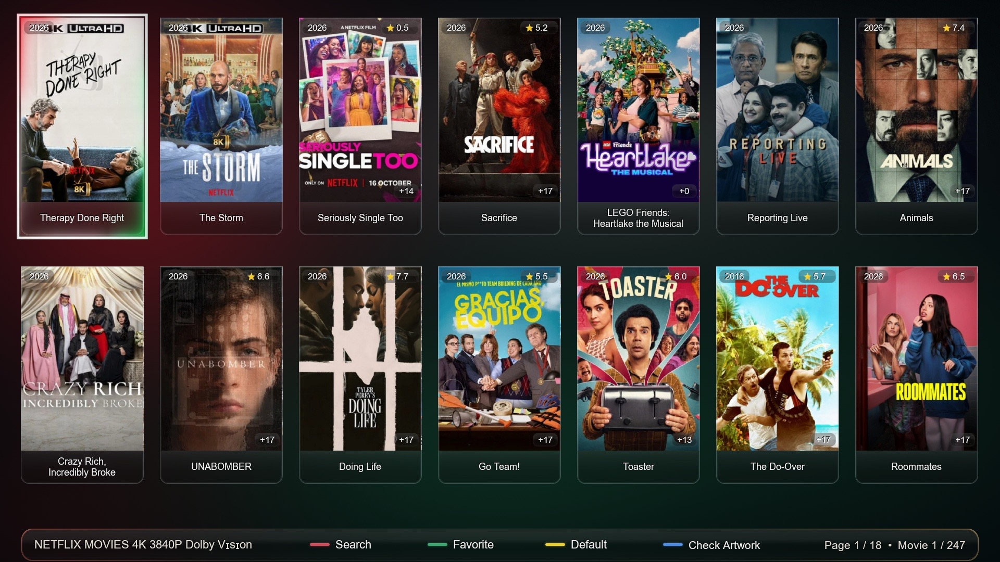](docs/screenshots/08_poster_grid.jpg)<br>**Poster Grid** |
|:---:|:---:|
| [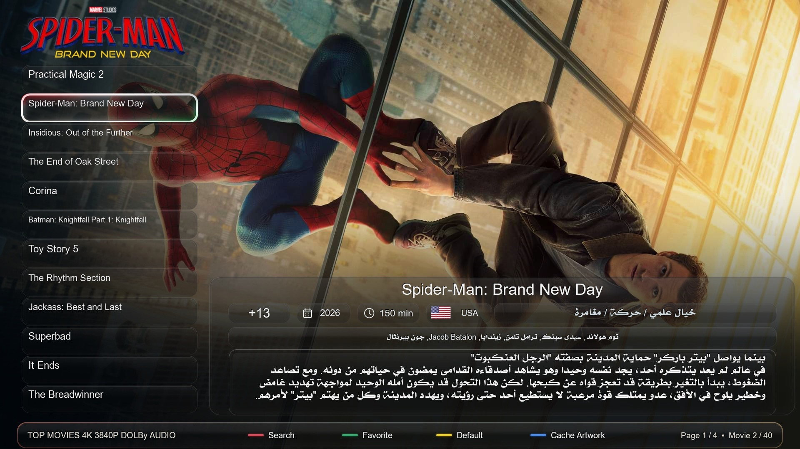](docs/screenshots/06_movie_details.jpg)<br>**Movie Details** | [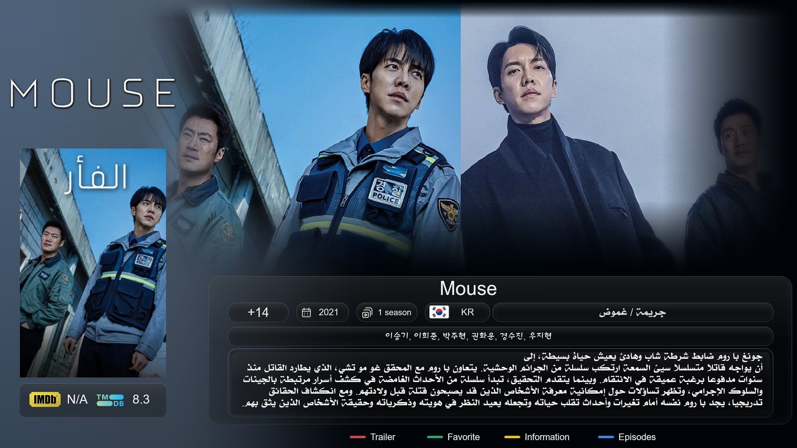](docs/screenshots/13_series_details.jpg)<br>**Series Details** |

<details>
<summary><b>More cinematic views — Discovery & Series Grid</b></summary>

<br>

[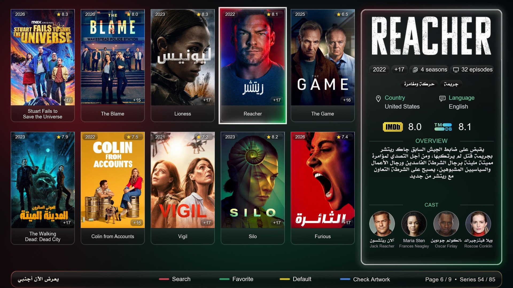](docs/screenshots/07_cinematic_discovery.jpg)

[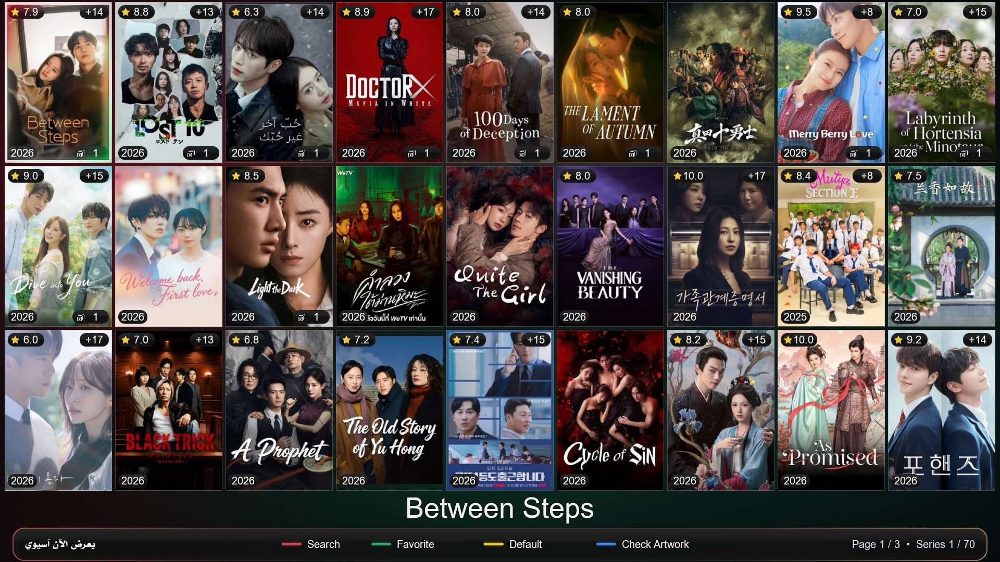](docs/screenshots/09_series_grid.jpg)

</details>

### 🔎 Search — Find what you love

Global media search, movie and series categorization, progressive server results and search history.

[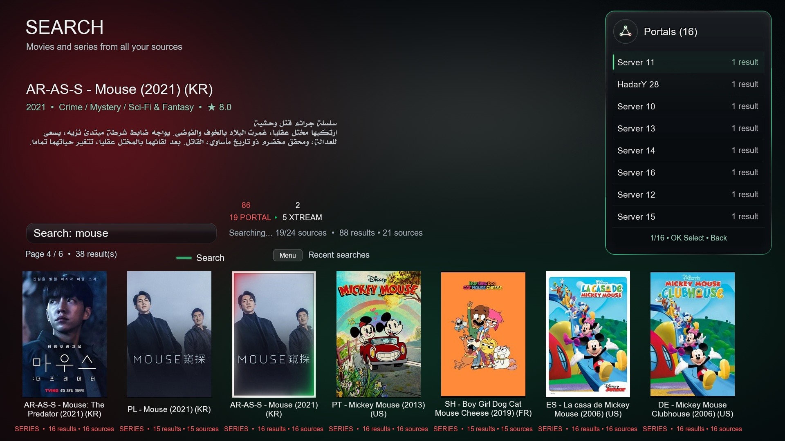](docs/screenshots/14_search.jpg)

### 💚 Your library — Local Media & Favorites

Enjoy your local HDD/USB library and organize favorite sources and content without leaving the Ultra Stalker experience.

| [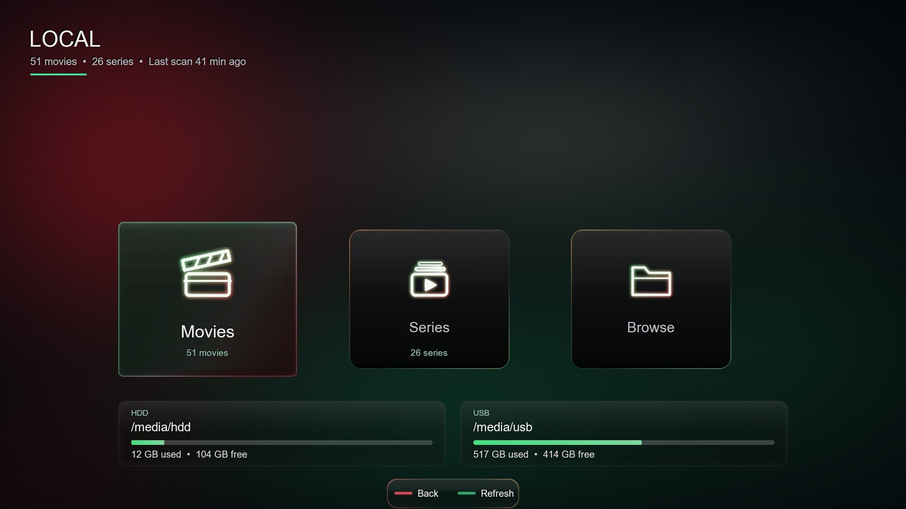](docs/screenshots/11_local_library.jpg)<br>**Local Library** | [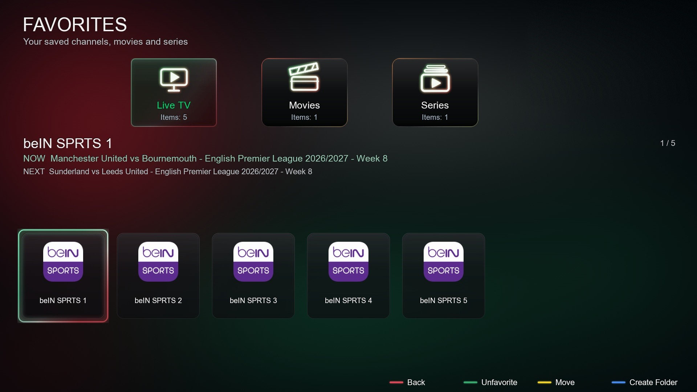](docs/screenshots/12_favorites.jpg)<br>**Favorites** |
|:---:|:---:|

### ⚙️ Portal management & fine control

Manage saved Portal and M3U sources, then fine-tune playback, language, performance, appearance and storage settings.

| [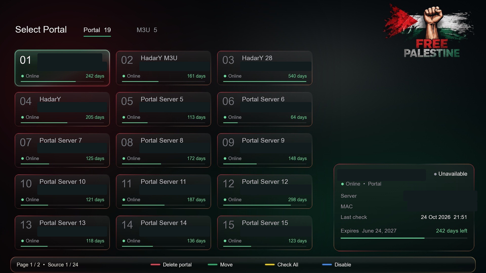](docs/screenshots/01_portal_manager_private.jpg)<br>**Portal Management**<br><sub>Private MAC addresses and server URLs are permanently redacted.</sub> | [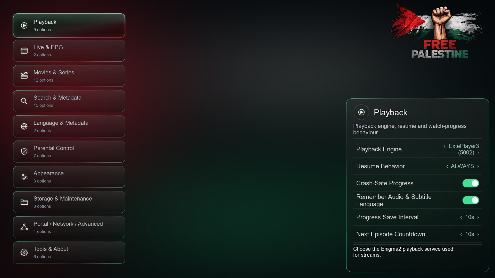](docs/screenshots/15_settings.jpg)<br>**Settings** |
|:---:|:---:|

---

[](assets/section-features.svg)

## 🧩 Built around your media

| Experience | What Ultra Stalker offers |
|:---|:---|
| 📺 **Live TV** | Portal, Xtream and M3U sources; EPG Now/Next; stream quality detection; automatic stream retry. |
| 🎬 **Movies & Series** | Cinematic and Poster Grid interfaces, smart metadata matching, official artwork and Title Logos when available. |
| 🎭 **Content Details** | Overviews, ratings, genres, cast, runtime, writer and director details when metadata is available. |
| 🔍 **Search** | Live TV, movies and series search; server-wide discovery and search history. |
| 💾 **Local Media** | Movies, series, season/episode detection, folder browsing and indexed HDD/USB media. |
| ⭐ **Favorites** | Separate favorites, custom folders, manual reordering and organization. |
| 🎞️ **Playback** | A dedicated media player, aspect ratio controls, resume, subtitle options and InfoBar data. |
| 🌐 **Languages** | 29 interface languages, with RTL support and auto-fit localization. |
| 🌿 **Performance** | Persistent artwork cache, stable-focus loading and reduced repeated TMDb lookups. |
| 🛠️ **Management** | Web-based source management, backup/restore, export options and in-plugin online update. |

<details>
<summary><b>Discover more advanced capabilities</b></summary>

<br>

- Accurate TMDb identity matching, reusable posters/backdrops/logos and 1080p trailer preference when supported.
- Seasons and episodes recognition, including `S01E01` and `1x01` naming for local series.
- Local media remains available when a remote Portal is offline.
- Favorites organization, Enigma2 Bouquet export and M3U export.
- Embedded, external and online subtitle options, with SubsSupport integrations when available.
- Source status, offline handling and backup/restore of supported user settings.
- Safe-upgrade design intended to preserve portals, favorites, history and artwork caches.

</details>

---

## 🧷 Compatibility

| Requirement | Supported |
|:---|:---|
| **Platform** | Enigma2 receivers |
| **Python** | 3.12 – 3.15 |
| **Package manager** | `opkg` |
| **Access** | Root (Telnet / SSH) |
| **Sources** | Stalker Portal · Xtream Codes · M3U |
| **Local storage** | HDD / USB media indexing |

> These checks reflect the installer as published, rather than a guarantee of compatibility with every receiver or image.

---

[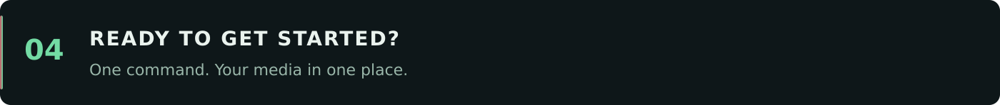](assets/section-installation.svg)

## 📦 Ready to get started

**For compatible Enigma2 receivers** — open a terminal or Telnet/SSH session as **root**, then run the official installer:

```sh
wget -qO- https://raw.githubusercontent.com/K3bOra/UltraStalker/main/install.sh | /bin/sh
```

Prefer reviewing the script first? [Read the official installer](install.sh) before running it.

**What the installer checks:** Python 3.12 or newer, the official release URL, and the IPK size, SHA-256, package identity, version and architecture before installation with `opkg`. The current package lists Python 3.12–3.15 support.

**Manual package:** [Download the latest IPK from Releases](https://github.com/K3bOra/UltraStalker/releases/latest).

> ℹ️ **Version note:** the current plugin version is **V9.2.3 (Revision 570)**. The installer and current plugin updater read the [manifest attached to the latest official release](https://github.com/K3bOra/UltraStalker/releases/latest/download/update.json). The repository [`update.json`](update.json) is a synchronized copy.

> ⚠️ Installation and updates require receiver access and may restart Enigma2. **Back up important receiver configuration first.**

---

## 🆕 What's New

<div align="center">

[](update.json)
[](update.json)

</div>

**Ultra Stalker V9.2.3 · Revision 570**

- **Subtitle preservation fix** for late-mounted storage (HDD/USB that appears after boot).
- **Buffered reader handoff fix** for smoother, more reliable playback.
- **General stability and reliability improvements.**

<details>
<summary><b>🇸🇦 جديد النسخة بالعربي</b></summary>

<br>

**الترا ستوكر V9.2.3 · مراجعة 570**

- **إصلاح الحفاظ على الترجمة** مع وحدات التخزين اللي بتتوصّل متأخّر (هارد/فلاشة بتظهر بعد التشغيل).
- **إصلاح تسليم قارئ البافر** لتشغيل أنعم وأكثر ثباتًا.
- **تحسينات عامة في الاستقرار والموثوقية.**

</details>

<details>
<summary><b>Previously in V9.2.2</b></summary>

<br>

- **Player New & Player New 2** — glass info bars for Live, Movies and Series with a Sub/Audio line, real picture size and a clearer buffer line.
- **Next Episode card** — countdown, Play now, and Autoplay off.
- **Richer series data** — episode names and runtimes filled from TMDB.
- **Info Bar Timeout** — adjustable from 3 seconds up to Always On.
- **Export** a Live, Movies or Series folder, or add it to a Bouquet, with a progress bar.
- **Hidden categories** stay hidden everywhere, while the *All* row is kept.
- **Home shortcut** — press **BLUE** for quick settings.
- **Premium web cards** for Movies, Series, Live, Local and Search, with glowing Details pages.

</details>

> 🌍 Release notes are localized inside [`update.json`](update.json) — the plugin shows them in your chosen interface language during an online update.

---

[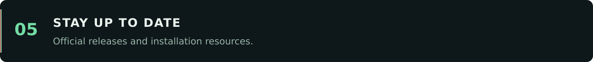](assets/section-updates.svg)

## 🔄 Stay up to date

- [**Releases**](https://github.com/K3bOra/UltraStalker/releases) — published build downloads.
- [**Release update.json**](https://github.com/K3bOra/UltraStalker/releases/latest/download/update.json) — manifest used by the installer and current plugin updater.
- [**Repository update.json**](update.json) — synchronized version metadata and localized update notes.
- [**Publishing guide**](RELEASING.md) — how to prepare and publish future verified releases.
- [**install.sh**](install.sh) — installer used by the public installation command.
- [**CHANGELOG.md**](CHANGELOG.md) — version notes and documentation changes.

---

## 🧰 Troubleshooting & FAQ

<details>
<summary><b>The installer stops or fails — what do I check first?</b></summary>

<br>

Make sure you are logged in as **root**, your receiver has an active internet connection, and Python is within **3.12–3.15**. Free up some temporary storage and run the install command again.

</details>

<details>
<summary><b>My Portal shows offline — did I lose everything?</b></summary>

<br>

No. Local media stays available even when a remote Portal is offline, and your favorites, history and artwork cache are preserved. Re-check your Portal/M3U source details in **Portal Management**.

</details>

<details>
<summary><b>Posters or artwork aren't loading.</b></summary>

<br>

Artwork relies on TMDb metadata matching and a persistent cache. Give it a moment on first browse, confirm the receiver has internet access, and the cache will fill in and reuse images afterward.

</details>

<details>
<summary><b>Will updating wipe my portals and settings?</b></summary>

<br>

The upgrade is designed to preserve portals, favorites, history and artwork caches. Even so, it's good practice to back up receiver configuration before any update.

</details>

<details>
<summary><b>How do I share a screenshot safely?</b></summary>

<br>

Always remove Portal URLs, server IPs, MAC addresses, user names, passwords, API keys and access tokens before posting. See [Privacy](#-share-with-confidence) below.

</details>

---

[](assets/section-arabic.svg)

## 🇸🇦 الدليل السريع بالعربي

**Ultra Stalker** واجهة متكاملة لأجهزة Enigma2، تشمل البث المباشر، الأفلام، المسلسلات، البحث، المفضلة والمكتبة المحلية من USB أو HDD.

**طريقة التثبيت:**
افتح Telnet أو SSH على الرسيفر بصلاحية `root`، ونفّذ أمر التثبيت الرسمي الموجود في قسم [**Ready to get started**](#-ready-to-get-started) بالأعلى. يُفضّل الاحتفاظ بنسخة احتياطية من إعدادات الجهاز قبل التحديث.

**المميزات باختصار:**
- بث مباشر عبر Portal و Xtream و M3U مع دليل القنوات (EPG).
- أفلام ومسلسلات بعرض سينمائي وبوسترات وبيانات كاملة.
- بحث شامل، مفضلة منظّمة، ومكتبة محلية من الهارد أو الفلاشة.
- ٢٩ لغة للواجهة مع دعم الكتابة من اليمين لليسار.

**خصوصية الصور:** جميع أرقام MAC وروابط السيرفر الظاهرة في لقطة صفحة البورتلات تم إخفاؤها نهائيًا قبل تجهيزها للنشر.

---

[](assets/section-privacy.svg)

## 🔒 Share with confidence

When sharing screenshots or reporting problems publicly, always remove **Portal URLs, server IPs, MAC addresses, user names, passwords, API keys and access tokens**. In this gallery, the Portal Manager screenshot has been permanently sanitized — **no original identifiers are included in the published image**.

---

## 📄 License

Released under the [MIT License](LICENSE).

---

<div align="center">

**ULTRA STALKER** · *Premium media experience for Enigma2*

Developed and maintained by the project team · [GitHub Repository](https://github.com/K3bOra/UltraStalker)

</div>

